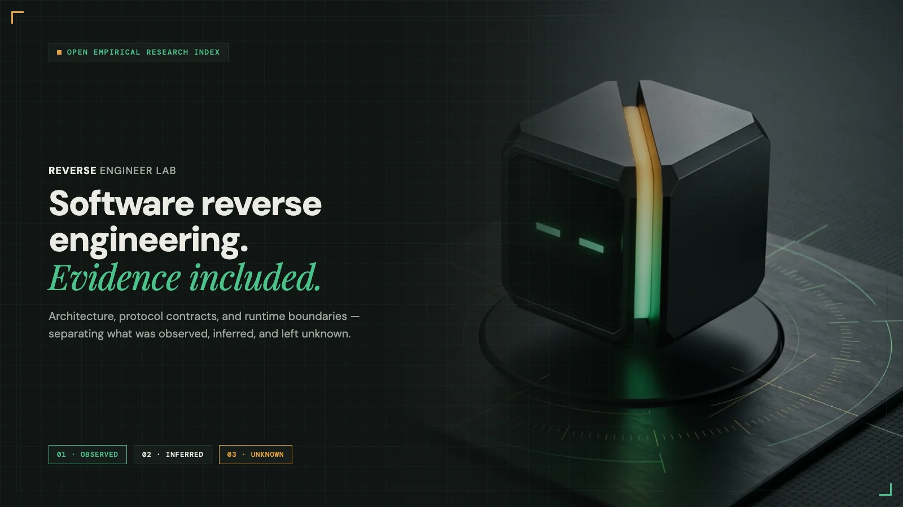

  <picture>
    <source media="(prefers-color-scheme: dark)" srcset=".github/assets/banner-dark.webp">
    <source media="(prefers-color-scheme: light)" srcset=".github/assets/banner-light.webp">
    
  </picture>

  

    
    
    
    
  

  

    <a href="https://reverseengineerlab.com">Live Catalog</a> ·
    <a href="https://reverseengineerlab.com/about">Methodology</a> ·
    <a href="https://reverseengineerlab.com/submit">Submit Research</a> ·
    <a href="#development">Development</a> ·
    <a href="#hosting">Hosting</a>
  

---

# Reverse Engineer Lab (REL)

An independent catalog of software reverse-engineering research, with evidence links and explicit observations, inferences and limitations. Not affiliated with Reverse Engineer Anything.

Built with Astro and EmDash CMS. Community submissions contain text and public HTTPS links only, and enter a private moderation queue. Editors approve publication or deny with a saved reason.

## Development

Run `npm ci` and `npm run dev`. Use the exact URL printed by Astro. EmDash development-only setup helpers may initialize a local fixture database; production never enables them.

Run `npm test`, `npm run typecheck`, and `npm run build` to validate the app. Run `node bin/verify-site.mjs URL` to check public routes and anonymous moderation protection.

## Hosting

The Cloudflare build uses D1 for persistent CMS data and R2 for media managed by EmDash. Public submissions never accept uploads. Set `CF_ACCESS_TEAM_DOMAIN` to the Access team domain before running `npm run build:cloudflare`. Set the deployed `CF_ACCESS_AUDIENCE` variable to the dedicated CMS application audience. Protect `/_emdash` with an owner-only Access application, with an exact public bypass only for `/_emdash/api/plugins/rea-catalog/submit`. `npm run build:cloudflare` builds the Worker; `npm run deploy` deploys the reviewed artifact.

Content belongs to the CMS after initialization. The catalog covers nineteen software investigations across commerce, accounting, operational SaaS, developer platforms, and native/voice AI agent harnesses using public and shipped-client evidence: Digits, Campfire, DOSS, Katana, Shiptheory, Shopify (Admin GraphQL, Aquifer/River/Roast, and Fall '26 Shop MCP & WASI CLI), Klaviyo, WooCommerce, Notion, Xero, Charles Schwab, Claude Code & Projects (Hearth), Capy, NotebookLM, ChatGPT / Codex, Google Antigravity, and Grok Bot. Entries distinguish observations, inferences and limitations. No private credentials, tenant records, or proprietary research artifacts are bundled.

Copyright belongs to the project owner. No project-wide open-source license has been selected yet; third-party dependencies retain their own licenses.
